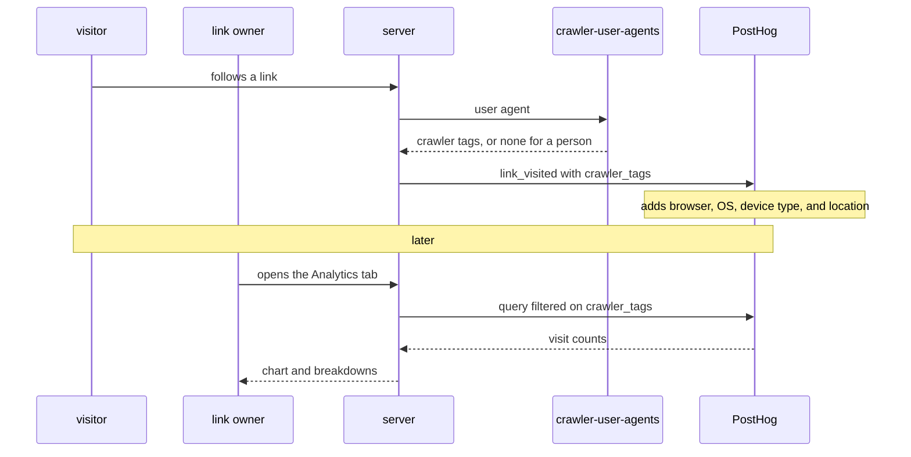

# Architecture

The [API reference](https://cmu.lol/api/scalar) lists every endpoint with its parameters and responses.

## User-agent rules

Links can have rules that redirect to different targets based on the visitor's `User-Agent`. If more than one rule matches a visitor, the one highest in the list wins.

A rule matches a platform, a regular expression, or a crawler category:

- Platforms are `ios`, `android`, `mobile`, `desktop`, `windows`, `macos`, `linux`, `chromeos`, and `bot`.
- Regular expressions are case-insensitive and can match anywhere in the user agent. For example, `CriOS/1[0-9]{2}` matches Chrome 100 through 199 on iOS.
- Crawler categories match the tags that [monperrus/crawler-user-agents](https://github.com/monperrus/crawler-user-agents) assigns to each crawler, like `ai-crawler` or `search-engine`. The full set of tags is available from `GET /api/crawler-tags`.

The main target has to be an `http` or `https` URL, but a rule's target can be an app link like `myapp://` or `intent://`.

## Analytics

The server sends these events to PostHog:

- `link_visited` when someone follows a link, with the slug, the matched rule, and the target they were sent to
- `link_not_found` when a path doesn't match any link or static file
- `link_inactive` when someone follows a paused or expired link, with the slug and a `reason` of `paused` or `expired`
- `link_created`, `link_updated`, and `link_deleted` when someone changes a link

Visitor events use a hash of the visitor's IP address, host, and user agent as the distinct ID. Besides PostHog's standard properties like `$referrer`, `$browser_language`, and the `utm_*` and ad click ID parameters, they record:

| Property | Value |
| -- | -- |
| `in_app_browser` | The app whose built-in browser opened the link, such as `instagram` or `tiktok` |
| `in_app_package` | The Android package name from `X-Requested-With` |
| `fetch_site` | The `Sec-Fetch-Site` header |
| `is_prefetch` | Whether the request was a prefetch |
| `gpc` | Whether the visitor sent a Global Privacy Control signal |
| `crawler_tags` | The [crawler-user-agents](https://github.com/ap-1/crawler-user-agents) tags of the crawler that sent the request, if it's a known crawler |

Link changes and frontend events both use the user's OIDC subject as the distinct ID and show up under the same person in PostHog.

## Visit stats

When someone follows a link, the server looks up their user agent with [crawler-user-agents](https://github.com/ap-1/crawler-user-agents) and adds the tags of the matching crawler to its `link_visited` event as `crawler_tags`. Visits from the QR code on a link's page also carry `utm_source=qr`. PostHog's User Agent Populator and GeoIP transformations then add the browser, OS, device type, country, and city.

The Analytics tab counts these events by querying PostHog. Visits recorded before the server started sending `crawler_tags` all count as people.
